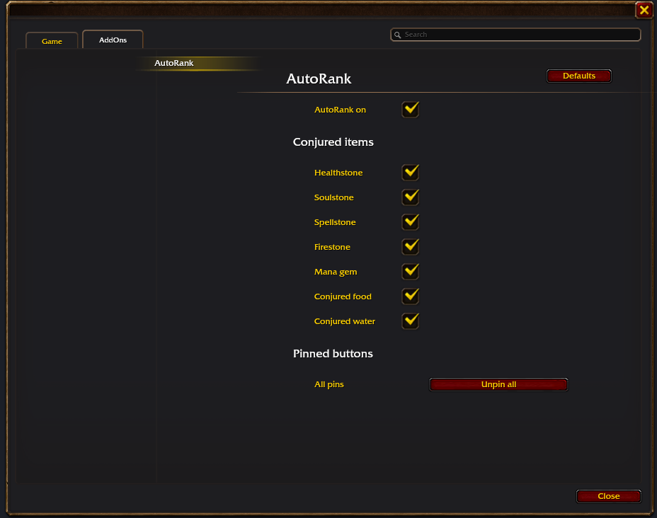

# AutoRank

Keeps the highest rank of your spells, and the best conjured items, on your action bars in
**WoW Forever**, without macros, and leaves the low ranks you chose on purpose alone.

## What it does

- **New ranks go on your bars by themselves.** When you learn a new rank, every button that
  held your previous top rank is swapped to the new one. Buttons hold the real spell, so you
  keep full tooltips, icons, cooldowns and range colouring. If you're in combat, it waits
  until combat ends.
- **Replacement spells count as the next rank.** Demon Skin to Demon Armor, Frost Armor to
  Ice Armor, Lesser Heal to Heal to Greater Heal, Bear Form to Dire Bear Form, Felsteed to
  Dreadsteed and Warhorse to Charger: the button holding your best of the old spell moves to
  the new one. Drag the old spell back from the spellbook to keep it.
- **Low ranks stay where you put them.** Drag a lower rank from the spellbook onto a button
  (Life Tap rank 1, a cheap Frost Armor...) and that button is pinned: AutoRank never
  upgrades it until something else goes on the button. It also never touches a button that
  didn't hold your top rank before.
- **Pet bar too.** Your pet's buttons move up to its new ranks, and autocast follows.
- **Conjured items**: a button holding a Healthstone, Soulstone, Spellstone, Firestone, mana
  gem, or conjured food or water is switched to the best one of that kind in your bags that
  you can use, out of combat. With none in your bags the button is left alone. A mage's
  button per mana gem is kept.
- **Plain /cast macros back to spells**: `/autorank unmacro` lists bar macros that only say
  `/cast Spell` (with or without `#showtooltip`); `/autorank unmacro apply` puts the real
  spell on those buttons. The macros themselves are kept.

It never moves anything while you're dragging something on the cursor.

## Settings

Esc > Options > AddOns > AutoRank (or `/autorank`): turn it all off, turn each conjured
item off, and unpin every button.

## Commands

| Command | |
|---|---|
| `/autorank` | Open the settings |
| `/autorank help` | The list of commands |
| `/autorank status` | What it's doing now |
| `/autorank all` | Raise every unpinned button to your top rank now |
| `/autorank off`, `/autorank on` | Stop or resume everything (off leaves your bars alone) |
| `/autorank pins` | Buttons kept at a low rank on purpose |
| `/autorank unpin [slot]` | Let one pinned button (or all of them) upgrade again |
| `/autorank <item> on\|off` | One conjured item swap: `healthstone`, `soulstone`, `spellstone`, `firestone`, `gem`, `food`, `water` |
| `/autorank stones on\|off` | The four warlock stones at once |
| `/autorank unmacro [apply]` | Preview, or do, the macro to spell swap |
| `/autorank debug` | Spellbook size and every bar macro, for bug reports |

## Install

From CurseForge or Wago with your addon manager, or download a release zip from GitHub and
copy its `AutoRank` folder into `World of Warcraft\_forever_\Interface\AddOns`. Restart WoW
fully (a `/reload` doesn't find new addons).

No other addons needed.

## Limits

- Ranks are read from the spell's "Rank N" text and the client's own word for Rank; made
  and tested on an English client.
- Pins are saved per character and per button slot. Moving a pinned spell to another slot
  pins it there instead.
- A replacement you learned before installing 1.1.0 doesn't move your bars on its own:
  `/autorank all` does it once.
- Only action slots 1 to 180 are looked at.

## Licence

[MIT](LICENSE)
